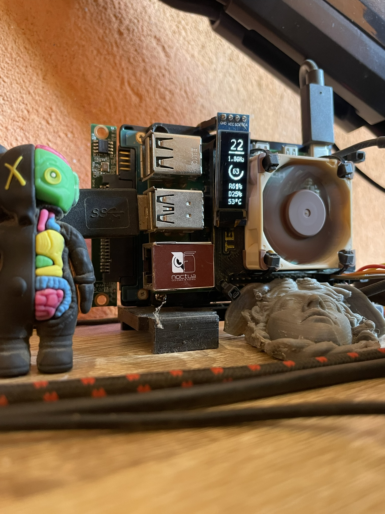
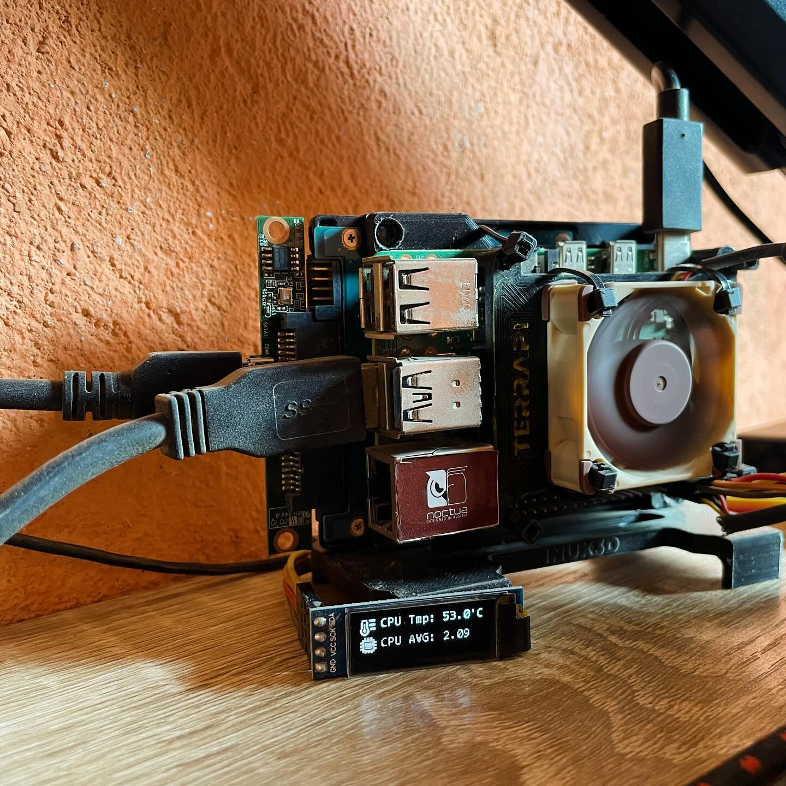
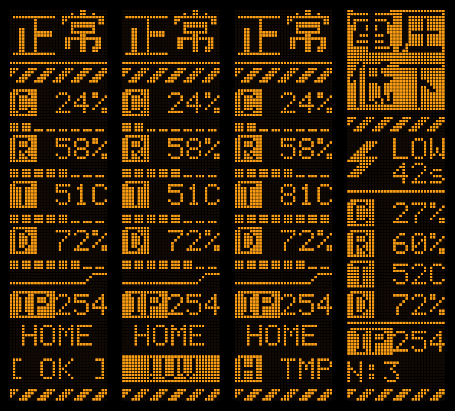
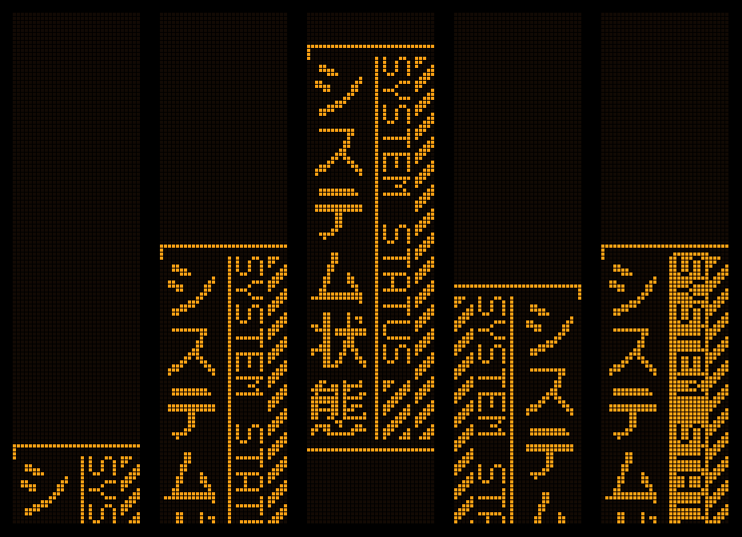

# Raspberry Pi 4 i2c OLED Display for show stats
this project is a simple way to show some stats on a i2c OLED display connected to a Raspberry Pi 4 using Python.
Enjoy!

## Requirements
- Raspberry Pi 4
- i2c OLED Display (128x32)
- Python 3

## Installation 
1. Enable i2c on Raspberry Pi
    * `sudo raspi-config`
    * Go to `Interfacing Options`
    * Go to `I2C`
    * Enable I2C
    * Reboot
2. Install required libraries
    * `pip install smbus2`
    * `pip install psutil`
    * `pip install Pillow`
    * `pip install adafruit-circuitpython-ssd1306`
3. Clone this repository
    * `git clone
4. Run the script for show stats
    * `python3 raspberry_stats.py`

## Use as service (optional)
1. Create a service file
    * `sudo nano /etc/systemd/system/raspberry_stats.service`
2. Copy i2c_python_stats.service content
3. Create a service timer file
    * `sudo nano /etc/systemd/system/raspberry_stats.timer`
4. Copy i2c_python_stats.timer content
5. Enable the service
    * `sudo systemctl enable raspberry_stats.service`
    * `sudo systemctl enable raspberry_stats.timer`
    * `sudo systemctl start raspberry_stats.timer`
3. Reload systemd
    * `sudo systemctl daemon-reload`
4. Check the status of the service
    * `sudo systemctl status raspberry_stats.service`

## Preview



Vista Evangelion (C++), generada con el preview off-device. Ver [más abajo](#vista-evangelion-alerta-de-voltaje-y-protección-de-pantalla-c).



## Implementaciones disponibles

Este repositorio ahora soporta dos variantes para mostrar estadísticas en la pantalla OLED:

1. Python (rápida de modificar / depende de librerías como Pillow y Adafruit)
2. C++ (memoria muy baja, ~1–2 MB RSS, sin dependencias pesadas)

Puedes instalar una u otra (o ambas) usando el `Makefile` con la variable `MODE`.

| Modo | Servicio systemd | Binario / Script | Env file | Características |
|------|------------------|------------------|---------|-----------------|
| Python | `raspberrypi_stats_py.service` | `/usr/local/bin/raspberrypi_stats_py` | `/etc/default/raspberrypi_stats_py` | Fácil de extender, usa Pillow, donut CPU, rotación con PIL |
| C++ | `raspberrypi_stats_cpp.service` | `/usr/local/bin/raspberrypi_stats_cpp` | `/etc/default/raspberrypi_stats_cpp` | Muy ligero, donut CPU, escala proporcional IP, alerta de bajo voltaje, vista Evangelion, protección contra quemado, logging periódico |

## C++ port (opcional, low-memory)
La versión C++ bajo `cpp/` habla directo vía I2C al SSD1306 con una fuente 5x7 en memoria. Evita Pillow y reduce uso de RAM a ~1–2 MB. Render vertical (32x128 girado), donut de CPU, voltaje y flags de throttling, y log periódico para `journalctl`.

### Vista Evangelion, alerta de voltaje y protección de pantalla (C++)

#### Vistas
La versión C++ tiene dos layouts en vertical (32x128) y se elige con `RPI_STATS_VIEW`:

- `classic` (default): IP, frecuencia, donut de CPU y RAM/DISK/TEMP alternando.
- `eva`: estilo Evangelion. Cabecera 正常 ("normal"), franjas de peligro, etiquetas invertidas
  C/R/T/D con barras segmentadas, IP, hostname y una línea de estado.
- `cycle`: alterna entre las dos cada `RPI_STATS_CYCLE_SECS` segundos.


De izquierda a derecha: normal, hubo bajo voltaje desde el arranque (`!UV`),
límite de temperatura activo (`H TMP`) y alerta de bajo voltaje (電圧低下).

#### Alerta de bajo voltaje
Se lee `vcgencmd get_throttled` cada segundo. Si `vcgencmd` no está disponible, se usa
`in0_lcrit_alarm` del driver hwmon `rpi_volt`.

- Bit 0 (bajo voltaje **ahora**): pantalla de alerta completa que parpadea invertida
  (rayo, tiempo en alerta, número de eventos). Se queda `RPI_STATS_UV_HOLD` segundos
  después de normalizarse, para que también se vean las caídas cortas.
- Bit 16 (hubo bajo voltaje **desde el arranque**): marca `!UV` permanente hasta reiniciar.
- Bits 1-3 / 17-19 (frecuencia limitada, throttling, límite de temperatura): `H TMP/CAP/THR` o `!TH`.
- Cada cambio de estado se registra como `ALERT` / `WARN` / `INFO` en stdout, stderr y syslog
  (`journalctl -t raspberrypi_stats`).

> La Pi 4 no puede medir el voltaje de entrada; el firmware solo indica que bajó del umbral
> (~4.63 V). El voltaje de `vcgencmd measure_volts core` es el del núcleo del CPU, no el de la
> fuente, por eso ya no se usa para la alerta.

#### Protección contra quemado (burn-in)
Activa por defecto. Cualquier alerta se salta todo esto y sube el brillo al máximo.

- **Brillo bajo**: contraste `0x20` en lugar de `0x8F`.
- **Apagado nocturno**: panel apagado de 23:00 a 07:00.
- **Protector**: después de 5 min de métricas aparece un banner システム状態 / SYSTEM STATUS
  (tategaki) que sube por la pantalla y cambia de lado en cada pasada. Cada minuto se
  muestran las métricas 10 s. Si hubo bajo voltaje o throttling desde el arranque, la franja
  "SYSTEM STATUS" sale invertida.
- **Pixel shift**: las vistas fijas se desplazan 0-2 px en vertical cada 2 min.
- Al detener el servicio la pantalla queda en blanco (no congelada en el último frame).



#### Variables de entorno (C++)
| Variable | Default | Descripción |
|---|---|---|
| `RPI_STATS_LOG_INTERVAL` | `30` | Segundos entre líneas de log `stats ...` |
| `RPI_STATS_VIEW` | `classic` | `classic`, `eva` o `cycle` |
| `RPI_STATS_CYCLE_SECS` | `10` | Segundos por vista en modo `cycle` |
| `RPI_STATS_UV_HOLD` | `10` | Segundos que se mantiene la alerta tras normalizarse |
| `RPI_STATS_UV_BLINK` | `1` | `0` desactiva el parpadeo de la alerta |
| `RPI_STATS_CONTRAST` | `0x20` | Brillo normal (1-255, acepta hex) |
| `RPI_STATS_SLEEP` | `23:00-07:00` | Ventana con el panel apagado; `off` lo desactiva |
| `RPI_STATS_SAVER_AFTER` | `300` | Segundos de métricas antes del protector; `0` lo desactiva |
| `RPI_STATS_SAVER_PERIOD` | `60` | Duración de cada ciclo del protector (s) |
| `RPI_STATS_SAVER_PEEK` | `10` | Segundos de métricas dentro de cada ciclo |
| `RPI_STATS_SAVER_FPS` | `8` | Velocidad de animación del banner |
| `RPI_STATS_SHIFT` | `1` | `0` desactiva el pixel shift |
| `RPI_STATS_FAKE_THROTTLED` | | Solo pruebas: simula un valor, p. ej. `0x50005` |

Probar la alerta sin provocar un bajo voltaje real:
```fish
sudo systemctl stop raspberrypi_stats.service
RPI_STATS_VIEW=eva RPI_STATS_FAKE_THROTTLED=0x50005 ./build/raspberrypi_stats_cpp   # Ctrl-C para salir
sudo systemctl start raspberrypi_stats.service
```

#### Preview sin pantalla
`cpp/preview/` dibuja las vistas en el framebuffer y las exporta a PNG (solo usa la librería
estándar de Python). Así se generaron las capturas de arriba:
```fish
cd cpp
g++ -std=c++17 -I src preview/preview.cpp src/ssd1306.cpp src/eva_view.cpp src/portrait.cpp src/saver.cpp -o /tmp/preview
/tmp/preview > /tmp/preview.txt
python3 preview/render.py /tmp/preview.txt ../assets/images/eva_view.png "eva normal,eva !UV,eva temp,eva alert"
python3 preview/render.py /tmp/preview.txt ../assets/images/eva_screensaver.png saver
```

#### Kanji
Los glifos 16x16 (正常 電圧低下 システム状態) están en `cpp/src/kanji16.inc`, generados con
`cpp/tools/gen_kanji.py`, que usa Pillow y `fonts-droid-fallback`:
```fish
python3 cpp/tools/gen_kanji.py > cpp/src/kanji16.inc
```

### Build with Make (simplest)
Dependencies:
```fish
sudo apt-get install -y g++ libi2c-dev
```
Build:
```fish
make
```
Binary output: `build/raspberrypi_stats_cpp`

### Instalar como servicio systemd (ambos modos)
```fish
sudo make install MODE=cpp      # Instala versión C++
sudo make install MODE=python   # Instala versión Python
sudo systemctl daemon-reload
sudo systemctl enable --now raspberrypi_stats_cpp.service   # ó raspberrypi_stats_py.service
```
Archivos de entorno:
- C++: `/etc/default/raspberrypi_stats_cpp`
- Python: `/etc/default/raspberrypi_stats_py` (por ahora reservado)

Variables configurables (C++): ver la tabla en
[Vista Evangelion, alerta de voltaje y protección de pantalla](#vista-evangelion-alerta-de-voltaje-y-protección-de-pantalla-c)
y el ejemplo comentado en `systemd/raspberrypi_stats.env`.

Ver logs (seguimiento en vivo) C++:
```fish
journalctl -u raspberrypi_stats_cpp.service -f

Ver logs Python:
```fish
journalctl -u raspberrypi_stats_py.service -f
```
```

Desinstalar (elimina ambas variantes si existen):
```fish
sudo systemctl disable --now raspberrypi_stats_cpp.service
sudo systemctl disable --now raspberrypi_stats_py.service
sudo make uninstall

### Ejemplos rápidos

Instalar sólo Python y habilitar servicio:
```fish
sudo make install MODE=python
sudo systemctl daemon-reload
sudo systemctl enable --now raspberrypi_stats_py.service
```

Instalar sólo C++ y habilitar servicio:
```fish
sudo make install MODE=cpp
sudo systemctl daemon-reload
sudo systemctl enable --now raspberrypi_stats_cpp.service
```

Cambiar intervalo de log (C++):
```fish
sudo sed -i 's/RPI_STATS_LOG_INTERVAL=.*/RPI_STATS_LOG_INTERVAL=10/' /etc/default/raspberrypi_stats_cpp
sudo systemctl restart raspberrypi_stats_cpp.service
```

Ver última línea de log C++:
```fish
journalctl -u raspberrypi_stats_cpp.service -n 1
```

## Notas sobre dependencias Python

Asegúrate de tener instalados (ejemplo con pip):
```fish
pip install psutil Pillow adafruit-circuitpython-ssd1306 smbus2
```
Si usas entorno virtual, ajusta la unidad systemd para apuntar al intérprete correcto (modifica `ExecStart=` en `raspberrypi_stats_py.service`).
```

### Alternative: build with CMake
```fish
sudo apt-get install -y cmake g++ libi2c-dev
cmake -S cpp -B cpp/build
cmake --build cpp/build
./cpp/build/raspberrypi_stats_cpp
```

Si prefieres configuración manual, crea una unidad systemd propia apuntando al binario/script y recarga con `systemctl daemon-reload`.
